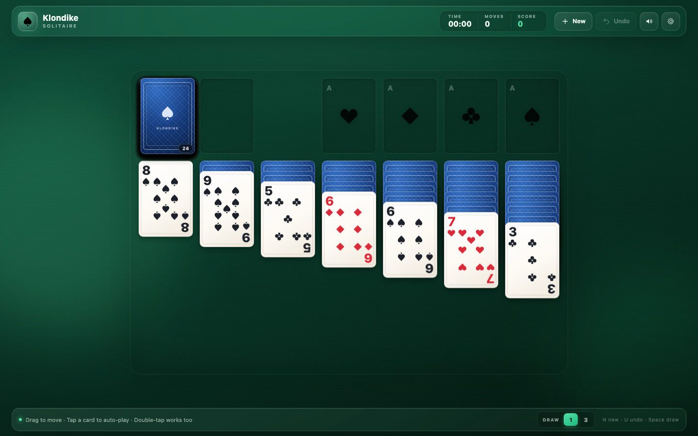
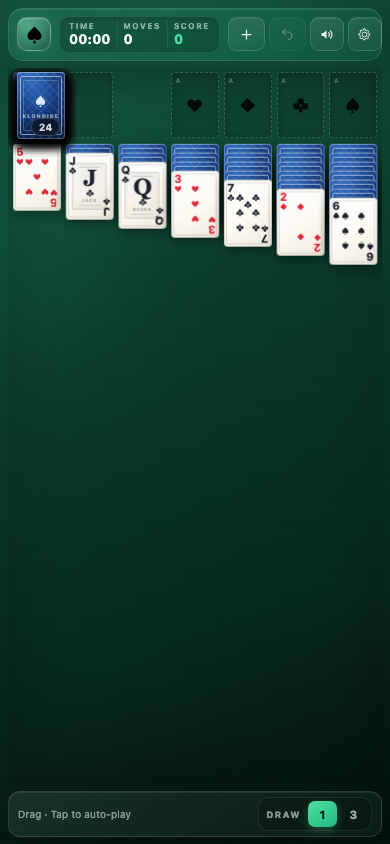
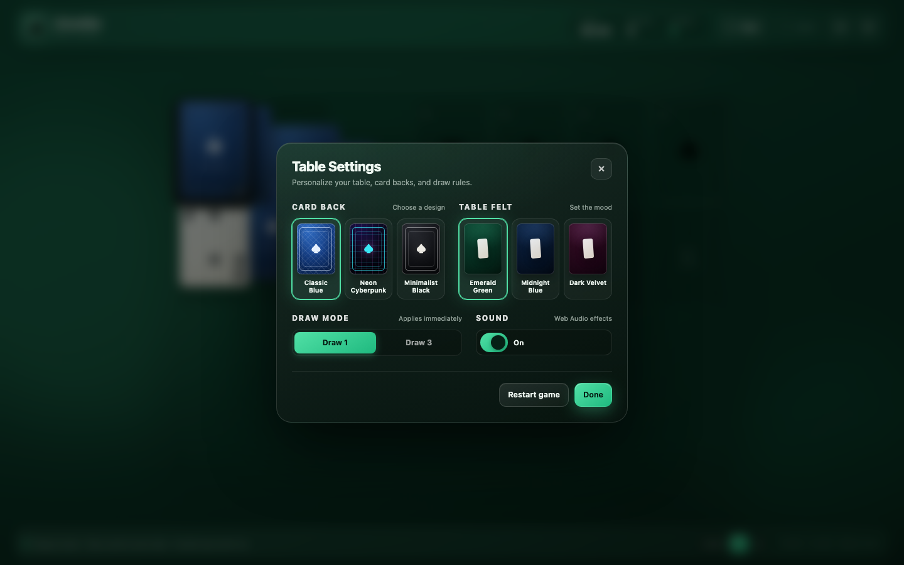
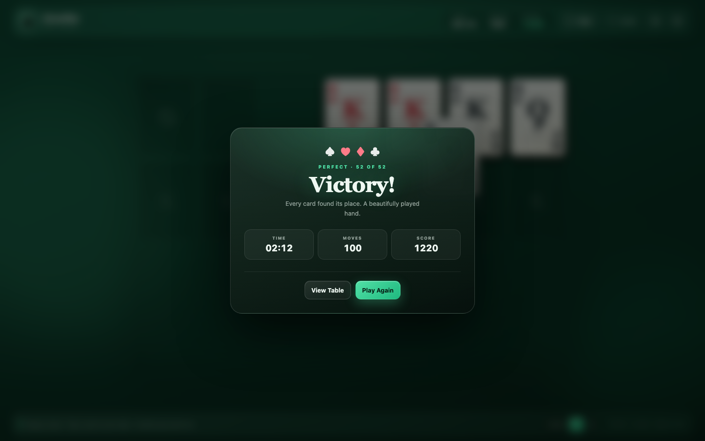

# Klondike · Solitaire

A complete, polished Klondike solitaire game in **one self-contained HTML file** — no build step, no dependencies, no external assets.

<p align="center">
  <a href="https://somphol.github.io/klondike-solitaire/"><strong>▶ Play it online</strong></a>
</p>



## Play

Open `index.html` in any modern browser, or serve the folder:

```bash
python3 -m http.server 8000
# then visit http://localhost:8000
```

## Features

- **Full Klondike rules** — seven tableau columns, four suit foundations, 24-card stock and waste.
- **Drag & drop** with Pointer Events for mouse, pen, and touch, including multi-card runs.
- **Tap / double-tap to auto-play** a card to its best legal home, with double-tap protection.
- **Draw 1 / Draw 3** toggle, applied immediately.
- **Stock recycle** by clicking the empty stock pile.
- **Unlimited undo** for every manual move, draw, and recycle.
- **Auto-Complete** appears when all tableau cards are face-up and a guaranteed win is detected.
- **Live timer, move counter, and standard solitaire scoring.**
- **Smooth animations** for dealing, drawing, moving, flipping, and auto-play.
- **Classic cascading victory animation** with all 52 cards.
- **Synthesized sound effects** via the Web Audio API — no audio files.
- **Autosave to localStorage**; refresh the page and the match is restored.
- **Custom themes** — Classic Blue, Neon Cyberpunk, and Minimalist Black card backs; Emerald Green, Midnight Blue, and Dark Velvet felts.
- **Responsive layout** for desktop, tablet, portrait, and landscape phones.
- **Offline-first**: the whole game is a single `index.html` (SVG icons are inline too).

## Controls

| Action | Desktop | Touch |
| --- | --- | --- |
| Move a card or run | Drag and drop | Drag and drop |
| Auto-play a card | Click / double-click | Tap / double-tap |
| Draw from stock | Click stock | Tap stock |
| Recycle waste | Click empty stock | Tap empty stock |
| Undo | `U` or `⌘/Ctrl + Z` | Undo button |
| New game | `N` | New button |
| Draw | `Space` or `D` | Draw button / stock |
| Settings | `S` | Gear button |
| Close dialog | `Esc` | Backdrop / × |

## Rules

- Tableau builds **down in alternating colors** (red 7 on black 8).
- Only **Kings** (or runs beginning with a King) may move to an empty tableau column.
- Foundations build **up from Ace to King in the same suit**.
- Only face-up cards can move; uncovering a face-down card flips it automatically.
- Cards may be moved from a foundation back to the tableau (for a score penalty).

## Scoring

| Move | Points |
| --- | --- |
| Card to foundation | +10 |
| Waste to tableau | +5 |
| Flip exposed tableau card | +5 |
| Foundation back to tableau | −15 |
| Recycle waste (Draw 1) | −100 |
| Recycle waste (Draw 3) | −20 |

Score never drops below zero. Draws, recycles, and card moves all count as moves.

## Under the hood

- `index.html` contains all markup, CSS, JavaScript, and SVG sprites.
- Cards are absolutely positioned and animated with `transform` transitions, so moves, deals, and auto-play stay smooth.
- Game state is a plain serializable object; every move snapshots it for undo.
- Web Audio oscillators and filtered noise generate every sound.
- Saves use `klondike.solitaire.state.v1` and `klondike.solitaire.settings.v1` in `localStorage`.

## Gallery

<table>
  <tr>
    <td align="center"><br><sub>Mobile portrait</sub></td>
    <td align="center"><br><sub>Card backs, felt, draw mode & sound</sub></td>
  </tr>
</table>



## License

MIT © 2026 Somphol Boonjing
